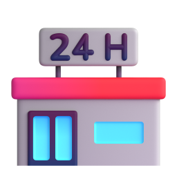
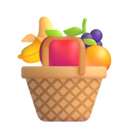
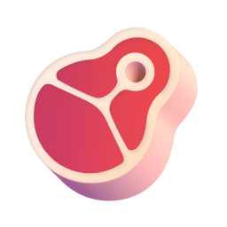
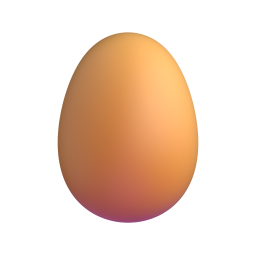

# S001 아이콘 에셋 — 동네 마트에서

| # | 단어 | 품사 | 구분 | 아이콘 | 출처 | 추천 모션 |
|---|---|---|---|---|---|---|
| 01 | 마트 | 명사 | 새 단어 |  | fluent · Convenience store | none |
| 02 | 과일 | 명사 | 새 단어 |  | manual · Fruit basket (Fluent 합성) | none |
| 03 | 채소 | 명사 | 새 단어 |  | fluent · Leafy green | none |
| 04 | 고기 | 명사 | 새 단어 |  | fluent · Cut of meat | none |
| 05 | 계란 | 명사 | 새 단어 |  | fluent · Egg | none |
| 06 | 우유 | 명사 | 새 단어 |  | fluent · Glass of milk | none |
| 07 | 가격 | 명사 | 새 단어 |  | fluent · Label | none |
| 08 | 카트 | 명사 | 새 단어 |  | fluent · Shopping cart | none |
| 09 | 봉투 | 명사 | 새 단어 |  | fluent · Shopping bags | none |
| 10 | 사다 | 동사 | 새 단어 |  | fluent · Money with wings | pop |
| 11 | 고르다 | 동사 | 새 단어 |  | fluent · Thinking face | pop |
| 12 | 담다 | 동사 | 새 단어 |  | fluent · Basket | pop |
| 13 | 계산하다 | 동사 | 새 단어 |  | fluent · Credit card | pop |
| 14 | 확인하다 | 동사 | 새 단어 | ❓ | 미정 | pop |
| 15 | 좋아하다 | 동사 | 새 단어 |  | fluent · Red heart | bounce |
| 16 | 비싸다 | 형용사 | 새 단어 |  | fluent · Money bag | shake |
| 17 | 싸다 | 형용사 | 새 단어 |  | fluent · Coin | bounce |
| 18 | 무겁다 | 형용사 | 새 단어 |  | fluent · Person lifting weights | shake |
| 19 | 맛있다 | 형용사 | 새 단어 |  | fluent · Drooling face | bounce |
| 20 | 맵다 | 형용사 | 새 단어 |  | fluent · Hot pepper | shake |
| 21 | 조금 | 부사 | 새 단어 |  | fluent · Pinching hand | none |

## 못 찾은 단어
직접 찾아서 `python assets.py set <id> --file <경로> --license "..."`로 등록한다.

| 단어 | id | 검색어 | 링크 |
|---|---|---|---|
| 확인하다 | A2-V-026 | check | [Flaticon](https://www.flaticon.com/search?word=check%203d) · [Icons8](https://icons8.com/icons/set/check--style-3d-fluency) · [LottieFiles](https://lottiefiles.com/search?q=check&category=animations) |

## 출처 표기 (영상 설명란)

- 표기 필요한 아이콘 없음. Fluent Emoji 3D와 그것을 합성한 자체 제작 아이콘은 MIT 라이선스로 별도 표기 불필요.
