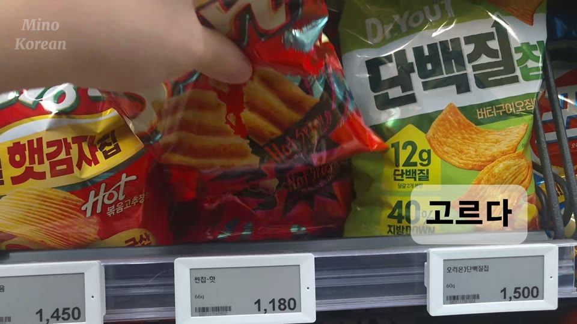
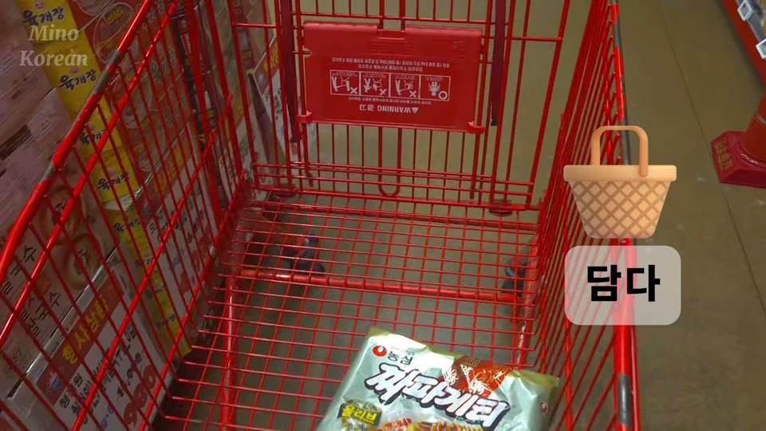
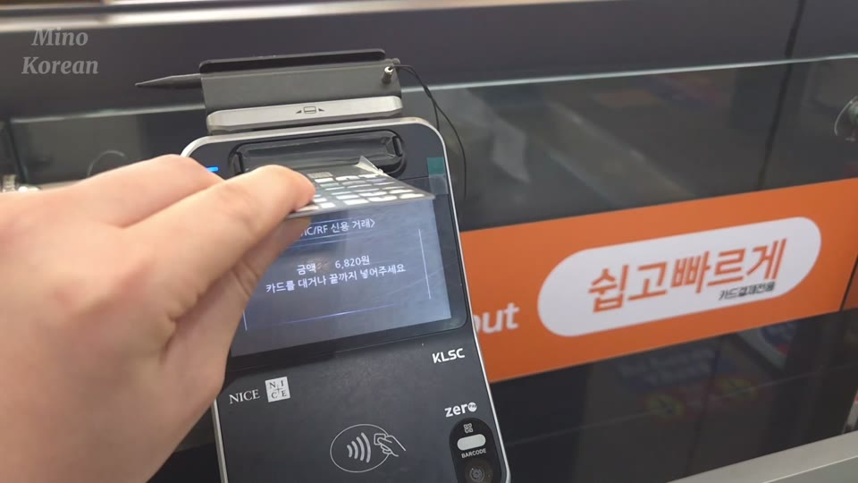

# S001 · At the Supermarket — Say It Yourself

**Sample study note.** The pictures come from the finished S001 video. This page is separate from the existing study note.

## What you can say after this video

Choose something, put it in a cart, and say how you pay. Look at each picture first. Then read the Korean line aloud and change one part to make it yours.

## 1. Choose one thing

**What Mino says:** **이 과자를 골라요.**

*I'll pick this snack.*

**Say it with a different food:** **이 라면을 골라요.**

*I'll pick this ramyeon.*

Look at the food, point to it, and say the whole Korean sentence aloud. **이** means *this*.

## 2. Put it in the cart

**What Mino says, in two short lines:**

**라면을 담아요.** — *I put the ramyeon in.*

**카트에 담아요.** — *I put it in the cart.*

**Put the ideas together:** **라면을 카트에 담아요.**

*I put the ramyeon in the cart.* This combined sentence is a practice example, not a line from the video.

**Your turn:** You put a snack in the cart. Say it in Korean using **과자** (*snack*).

> ＿＿＿＿＿＿＿＿＿＿＿＿＿＿＿＿＿＿＿＿

## 3. Pay for it

**What Mino says:** **카드로 계산해요.**

*I pay by card.*

**Change how you pay:** **현금으로 계산해요.**

*I pay in cash.* **현금** means *cash*.

**Your turn:** How do you usually pay? Choose **카드로** or **현금으로**, then say the whole sentence aloud.

## Check and take away

**Cart answer:** **과자를 카트에 담아요.** — *I put the snack in the cart.*

Try saying these without reading the English:

1. **이 과자를 골라요.** — I choose this snack.
2. **과자를 카트에 담아요.** — I put the snack in the cart. *(Practice sentence.)*
3. **카드로 계산해요.** — I pay by card.

Now change **과자** to something you buy, and **카드로** to the way you pay.
