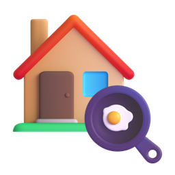
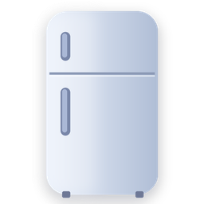
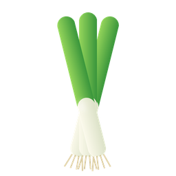
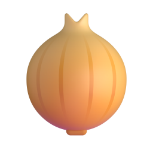
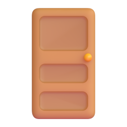
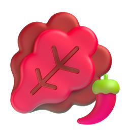
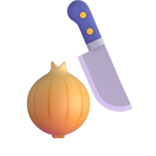
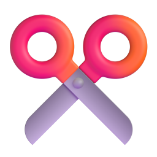
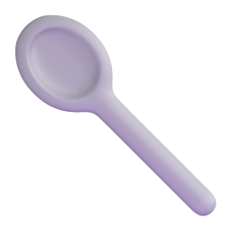

# S002 아이콘 에셋 — 우리 집 부엌에서

| # | 단어 | 품사 | 구분 | 아이콘 | 출처 | 추천 모션 |
|---|---|---|---|---|---|---|
| 01 | 집 | 명사 | 새 단어 |  | fluent · House | none |
| 02 | 부엌 | 명사 | 새 단어 |  | manual · House + Cooking | none |
| 03 | 배고프다 | 형용사 | 새 단어 |  | manual · Pleading face + Fork and knife | shake |
| 04 | 밥 | 명사 | 새 단어 |  | fluent · Cooked rice | none |
| 05 | 먹다 | 동사 | 새 단어 |  | fluent · Fork and knife with plate | shrink |
| 06 | 요리하다 | 동사 | 새 단어 |  | fluent · Cook | none |
| 07 | 냉장고 | 명사 | 새 단어 |  | manual · Refrigerator (직접 그림) | none |
| 08 | 열다 | 동사 | 새 단어 |  | manual · Door (open) | rotate |
| 09 | 꺼내다 | 동사 | 새 단어 |  | manual · Basket + Pinching hand + Red apple | slide |
| 10 | 파 | 명사 | 새 단어 |  | manual · Green onion (직접 그림) | none |
| 11 | 양파 | 명사 | 새 단어 |  | fluent · Onion | none |
| 12 | 필요하다 | 형용사 | 새 단어 |  | fluent · Red exclamation mark | bounce |
| 13 | 닫다 | 동사 | 새 단어 |  | fluent · Door | rotate |
| 14 | 김치 | 명사 | 새 단어 |  | manual · Leafy green(red) + Hot pepper | none |
| 15 | 그릇 | 명사 | 새 단어 |  | fluent · Bowl with spoon | none |
| 16 | 넣다 | 동사 | 새 단어 |  | fluent · Inbox tray | slide |
| 17 | 밥솥 | 명사 | 새 단어 | ❓ | 미정 | none |
| 18 | 안 | 명사 | 새 단어 | ❓ | 미정 | none |
| 19 | 주걱 | 명사 | 새 단어 | ❓ | 미정 | none |
| 20 | 재료 | 명사 | 새 단어 |  | manual · Carrot + Onion + Egg | none |
| 21 | 만들다 | 동사 | 새 단어 |  | fluent · Cook | pop |
| 22 | 썰다 | 동사 | 새 단어 |  | manual · Onion + Kitchen knife | slide |
| 23 | 그리고 | 부사 | 새 단어 | ❓ | 미정 | none |
| 24 | 자르다 | 동사 | 새 단어 |  | fluent · Scissors | slide |
| 25 | 프라이팬 | 명사 | 새 단어 |  | fluent · Cooking | none |
| 26 | 위 | 명사 | 새 단어 | ❓ | 미정 | none |
| 27 | 올리다 | 동사 | 새 단어 | ❓ | 미정 | none |
| 28 | 켜다 | 동사 | 새 단어 |  | fluent · Light bulb | pop |
| 29 | 불 | 명사 | 새 단어 |  | fluent · Fire | none |
| 30 | 빨간색 | 명사 | 새 단어 | ❓ | 미정 | none |
| 31 | 볶다 | 동사 | 새 단어 |  | fluent · Shallow pan of food | rotate |
| 32 | 다 | 부사 | 새 단어 | ❓ | 미정 | none |
| 33 | 섞다 | 동사 | 새 단어 |  | manual · Bowl with spoon + Cyclone | rotate |
| 34 | 냄새 | 명사 | 새 단어 |  | fluent · Nose | none |
| 35 | 좋다 | 형용사 | 새 단어 | ❓ | 미정 | bounce |
| 36 | 소금 | 명사 | 새 단어 |  | fluent · Salt | none |
| 37 | 후추 | 명사 | 새 단어 | ❓ | 미정 | none |
| 38 | 맛보다 | 동사 | 새 단어 |  | fluent · Face savoring food | bounce |
| 39 | 싱겁다 | 형용사 | 새 단어 |  | fluent · Face with diagonal mouth | bounce |
| 40 | 더 | 부사 | 새 단어 | ❓ | 미정 | none |
| 41 | 뜨겁다 | 형용사 | 새 단어 |  | manual · Hot beverage + steam curves | shake |
| 42 | 깨다 | 동사 | 새 단어 | ❓ | 미정 | none |
| 43 | 숟가락 | 명사 | 새 단어 |  | fluent · Spoon | none |
| 44 | 물 | 명사 | 새 단어 |  | fluent · Droplet | none |
| 45 | 따르다 | 동사 | 새 단어 |  | fluent · Pouring liquid | rotate |
| 46 | 마시다 | 동사 | 새 단어 |  | fluent · Bubble tea | shrink |
| 47 | 깨끗하다 | 형용사 | 새 단어 |  | fluent · Sparkles | bounce |
| 48 | 요리 | 명사 | 새 단어 |  | fluent · Pot of food | none |
| 49 | 계란 | 명사 | 복습 |  | fluent · Egg | none |
| 50 | 담다 | 동사 | 복습 |  | fluent · Basket | pop |
| 51 | 조금 | 부사 | 복습 |  | fluent · Pinching hand | none |
| 52 | 맛있다 | 형용사 | 복습 |  | fluent · Drooling face | bounce |
| 53 | 맵다 | 형용사 | 복습 |  | fluent · Hot pepper | shake |

## 검토 필요
자동 확정하지 않은 매칭. `python assets.py set <id> --emoji "이름"`으로 확정한다.

| 단어 | id | 뜻 | 후보 (점수) |
|---|---|---|---|
| 안 | A1-N-080 | inside | Diamond with a dot (60) |
| 그리고 | A1-ADV-031 | and | Nut and bolt (40), Bow and arrow (40), Couch and lamp (40), Fork and knife (40), Hammer and pick (40) |
| 위 | A1-N-078 | top/above | Top hat (60), Top arrow (60) |
| 올리다 | A2-V-057 | raise/post | Post office (60), Postal horn (60), Triangular flag (60), Japanese post office (60) |
| 빨간색 | A1-N-218 | red | Cherries (70), Red apple (60), Red circle (60), Red square (60), Pouting face (60) |
| 좋다 | A1-ADJ-001 | good | Person superhero (70), Man superhero (60), Woman superhero (60), Red envelope (30) |
| 깨다 | A2-V-165 | wake up/break | Broken chain (60), Broken heart (60) |

## 못 찾은 단어
직접 찾아서 `python assets.py set <id> --file <경로> --license "..."`로 등록한다.

| 단어 | id | 검색어 | 링크 |
|---|---|---|---|
| 밥솥 | B1-N-334 | rice cooker | [Flaticon](https://www.flaticon.com/search?word=rice%20cooker%203d) · [Icons8](https://icons8.com/icons/set/rice-cooker--style-3d-fluency) · [LottieFiles](https://lottiefiles.com/search?q=rice%20cooker&category=animations) |
| 주걱 | B1-N-333 | rice paddle | [Flaticon](https://www.flaticon.com/search?word=rice%20paddle%203d) · [Icons8](https://icons8.com/icons/set/rice-paddle--style-3d-fluency) · [LottieFiles](https://lottiefiles.com/search?q=rice%20paddle&category=animations) |
| 후추 | A2-N-252 | black pepper | [Flaticon](https://www.flaticon.com/search?word=black%20pepper%203d) · [Icons8](https://icons8.com/icons/set/black-pepper--style-3d-fluency) · [LottieFiles](https://lottiefiles.com/search?q=black%20pepper&category=animations) |

## 추상어 (장면 이미지 또는 생략)

- 다 (A1-ADV-011, all)
- 더 (A2-ADV-001, more)

## 출처 표기 (영상 설명란)

- 표기 필요한 아이콘 없음. Fluent Emoji 3D와 그것을 합성한 자체 제작 아이콘은 MIT 라이선스로 별도 표기 불필요.
