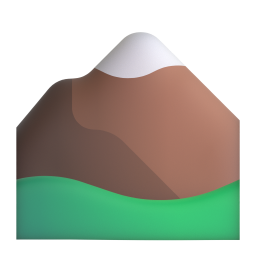
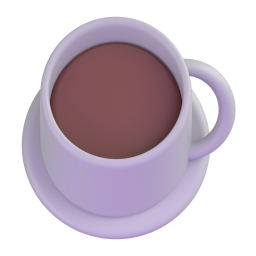
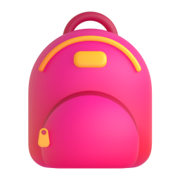
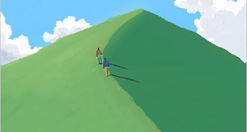
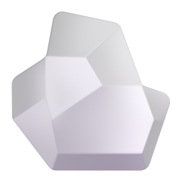
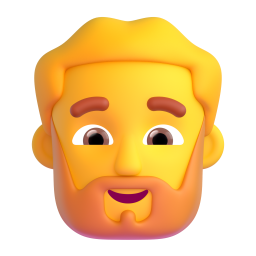
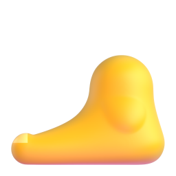
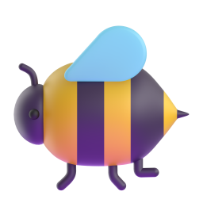
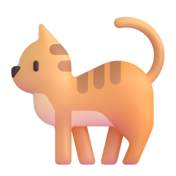
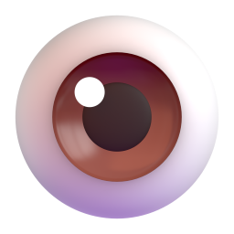

# S003 명사 아이콘 — 산에서

자막에서 뽑은 명사만. 동사·형용사는 이번에 만들지 않았다.

| # | 단어 | id | 아이콘 | 출처 | 비고 |
|---|---|---|---|---|---|
| 01 | 날씨 | A1-N-086 |  | fluent · Sun behind small cloud |  |
| 02 | 산 | A2-N-054 |  | fluent · Mountain |  |
| 03 | 바람 | A2-N-053 |  | fluent · Wind face |  |
| 04 | 운동 | A1-N-057 |  | fluent · Person running |  |
| 05 | 표지판 | — |  | manual · 직접 그림 (MIT, Fluent 스타일) | 사전 외 · 자막의 "휴지판" = 표지판 |
| 06 | 방향 | B1-N-383 |  | fluent · Compass |  |
| 07 | 아주머니 | — |  | 직접 준비 (`아주머니.jpg`) |  |
| 08 | 계단 | A2-N-270 |  | manual · Stairs (직접 그림) |  |
| 09 | 집 | A1-N-004 |  | fluent · House |  |
| 10 | 커피 | A1-N-101 |  | fluent · Hot beverage |  |
| 11 | 가방 | A1-N-047 |  | fluent · Backpack |  |
| 12 | 텀블러 | — |  | manual · 직접 그림 (MIT, Fluent 스타일) | 사전 외 |
| 13 | 뚜껑 | B1-N-331 |  | manual · Jar (lid open) |  |
| 14 | 오르막길 | — |  | 직접 준비 (`오르막길.jpg`) | 사전 외 |
| 15 | 길 | A1-N-074 |  | fluent · Motorway |  |
| 16 | 난간 | — |  | manual · 직접 그림 (MIT, Fluent 스타일) | 사전 외 |
| 17 | 손 | A1-N-089 |  | fluent · Raised hand |  |
| 18 | 경사 | — |  | 직접 준비 (`가파르다.jpg`) | 사전 외 |
| 19 | 울타리 | — |  | manual · 직접 그림 (MIT, Fluent 스타일) | 사전 외 |
| 20 | 지도 | A2-N-112 |  | fluent · World map |  |
| 21 | 위치 | B1-N-384 |  | fluent · Round pushpin |  |
| 22 | 돌 | — |  | fluent · Rock | 사전 외 |
| 23 | 사람들 | — |  | manual · Fluent 합성 (Woman + Person curly hair + Man) | "한국 사람들은" · 단수 사람(A1-N-001)은 icon_map에 Person으로 등록됨 |
| 24 | 소원 | B1-N-164 |  | manual · Folded hands + Sparkles |  |
| 25 | 운동기구 | — |  | manual · 직접 그림 (MIT, Fluent 스타일) | 사전 외 |
| 26 | 좌우 | — |  | 직접 준비 (`좌우.png`) | 사전 외 |
| 27 | 아저씨 | A1-N-190 |  | fluent · Man beard |  |
| 28 | 맨발 | — |  | fluent · Foot | 사전 외 (발 A2-N-360으로도 사용 가능) |
| 29 | 수다 | — |  | 직접 준비 (`수다떨다.avif`) | 사전 외 |
| 30 | 꽃 | A1-N-230 |  | fluent · Blossom |  |
| 31 | 벌 | — |  | fluent · Honeybee | 사전 외 |
| 32 | 고양이 | A1-N-107 |  | fluent · Cat |  |
| 33 | 눈 | A1-N-088 |  | fluent · Eye | eye 뜻으로 등록 |

## 아이콘 안 만든 명사

- 오늘, 지금, 저쪽, 하나: 시간·지시·수 표현
- 반대편, 옆, 안: 위치 표현 → 화면의 행동으로 충분 (공용 화살표 에셋 `assets/common/` 사용 가능)
- 목: "목이 말라요"는 S002의 목마르다 아이콘(`assets/icons/made/목마르다.png`) 재사용 권장
- 허리: 허리를 돌리는 동작이 화면에 나옴 → 공용 동그라미로 허리를 가리키면 충분
- 한국: Fluent 3D에 국기가 없음. 필요하면 태극기 이미지를 따로 구할 것

## 출처 표기 (영상 설명란)

- Fluent Emoji 3D 및 그것으로 만든 자체 제작 아이콘은 MIT — 별도 표기 불필요.
- 직접 준비한 파일(아주머니·오르막길·가파르다·좌우·수다떨다)은 받은 곳의 라이선스를 확인할 것.
