# S004 아이콘 에셋 — 화장실에서

| # | 단어 | 품사 | 구분 | 아이콘 | 출처 | 추천 모션 |
|---|---|---|---|---|---|---|
| 01 | 화장실 | 명사 | 새 단어 | 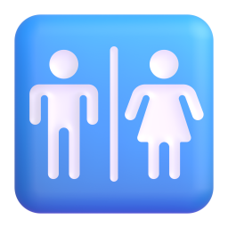 | fluent · Restroom | none |
| 02 | 들어가다 | 동사 | 새 단어 | 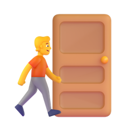 | manual · Door + Person walking | slide |
| 03 | 비누 | 명사 | 새 단어 | 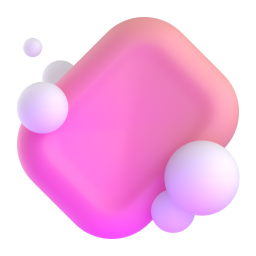 | fluent · Soap | none |
| 04 | 닦다 | 동사 | 새 단어 | 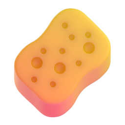 | fluent · Sponge | slide |
| 05 | 쓰다 | 동사 | 새 단어 | — | 장면 이미지 또는 생략 | none |
| 06 | 나오다 | 동사 | 새 단어 | 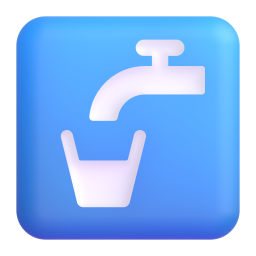 | fluent · Potable water | pop |
| 07 | 왼쪽 | 명사 | 새 단어 |  | fluent · Left arrow | none |
| 08 | 따뜻하다 | 형용사 | 새 단어 |  | fluent · Hot springs | bounce |
| 09 | 제일 | 부사 | 새 단어 |  | fluent · 1st place medal | none |
| 10 | 먼저 | 부사 | 새 단어 |  | fluent · Keycap 1 | none |
| 11 | 내다 | 동사 | 새 단어 | — | 장면 이미지 또는 생략 | none |
| 12 | 다음 | 명사 | 새 단어 |  | fluent · Next track button | none |
| 13 | 세수하다 | 동사 | 새 단어 |  | manual · Relieved face + Bubbles + Droplet | fade |
| 14 | 얼굴 | 명사 | 새 단어 |  | fluent · Slightly smiling face | none |
| 15 | 골고루 | 부사 | 새 단어 | — | 장면 이미지 또는 생략 | none |
| 16 | 다시 | 부사 | 새 단어 |  | fluent · Repeat button | none |
| 17 | 씻다 | 동사 | 새 단어 |  | manual · Raised hand + Bubbles | fade |
| 18 | 수건 | 명사 | 새 단어 | 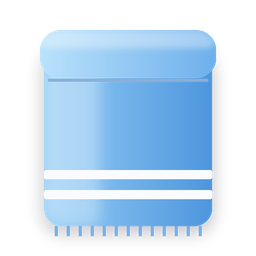 | manual · Towel (drawn) | none |
| 19 | 바꾸다 | 동사 | 새 단어 | 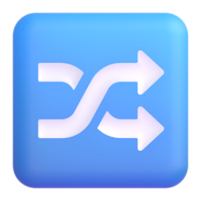 | fluent · Shuffle tracks button | rotate |
| 20 | 걸다 | 동사 | 새 단어 | 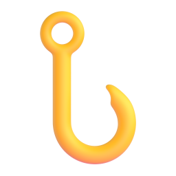 | fluent · Hook | slide |
| 21 | 칫솔 | 명사 | 새 단어 | 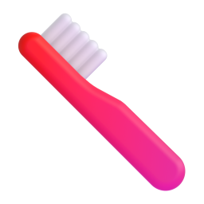 | fluent · Toothbrush | none |
| 22 | 마르다 | 동사 | 새 단어 | 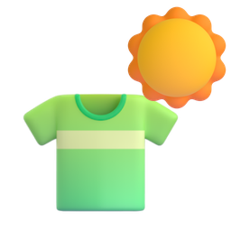 | manual · T-shirt + Sun | fade |
| 23 | 치약 | 명사 | 새 단어 | 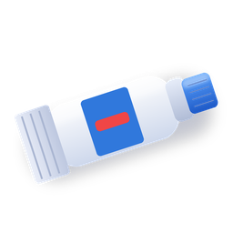 | manual · Toothpaste tube (drawn) | none |
| 24 | 컵 | 명사 | 새 단어 | 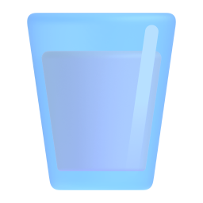 | manual · Glass of milk(water) | none |
| 25 | 받다 | 동사 | 새 단어 |  | manual · Palms up together + Droplet | pop |
| 26 | 입 | 명사 | 새 단어 | 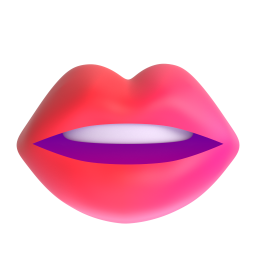 | fluent · Mouth | none |
| 27 | 나누다 | 동사 | 새 단어 | 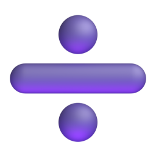 | fluent · Divide | none |
| 28 | 샤워 | 명사 | 새 단어 | 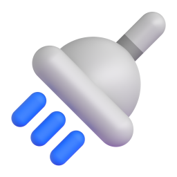 | fluent · Shower | none |
| 29 | 머리 | 명사 | 새 단어 | 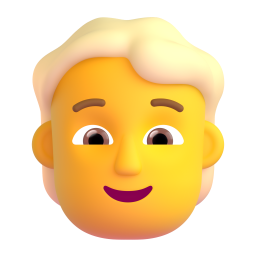 | fluent · Person blonde hair | none |
| 30 | 몸 | 명사 | 새 단어 | 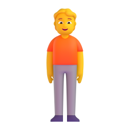 | fluent · Person standing | none |
| 31 | 누르다 | 동사 | 새 단어 | 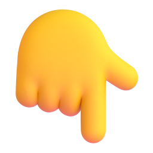 | fluent · Backhand index pointing down | pop |
| 32 | 발 | 명사 | 새 단어 |  | fluent · Foot | none |
| 33 | 불 | 명사 | 복습 |  | fluent · Fire | none |
| 34 | 켜다 | 동사 | 복습 | 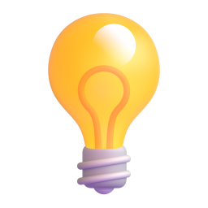 | fluent · Light bulb | pop |
| 35 | 손 | 명사 | 복습 |  | fluent · Raised hand | none |
| 36 | 물 | 명사 | 복습 |  | fluent · Droplet | none |
| 37 | 돌리다 | 동사 | 복습 |  | fluent · Counterclockwise arrows button | rotate |
| 38 | 뚜껑 | 명사 | 복습 |  | manual · Jar (lid open) | none |
| 39 | 열다 | 동사 | 복습 |  | manual · Door (open) | rotate |
| 40 | 닫다 | 동사 | 복습 |  | fluent · Door | rotate |
| 41 | 꺼내다 | 동사 | 복습 |  | manual · Basket + Pinching hand + Red apple | slide |
| 42 | 감다 | 동사 | 복습 |  | manual · Person blonde hair + Bubbles | fade |

## 출처 표기 (영상 설명란)

- 표기 필요한 아이콘 없음. Fluent Emoji 3D와 그것을 합성한 자체 제작 아이콘은 MIT 라이선스로 별도 표기 불필요.
